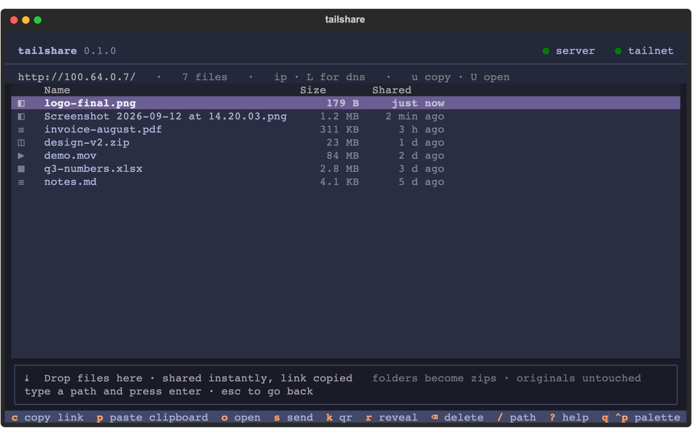
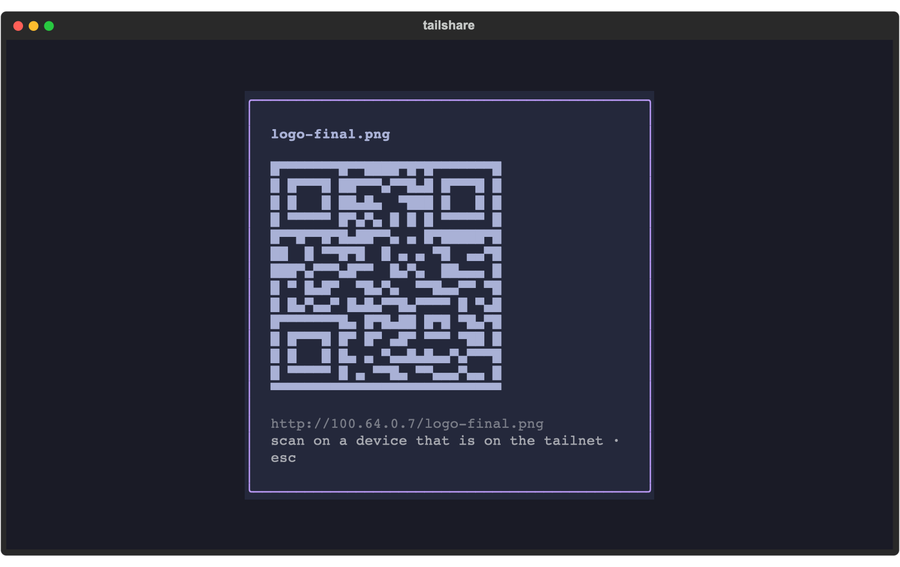
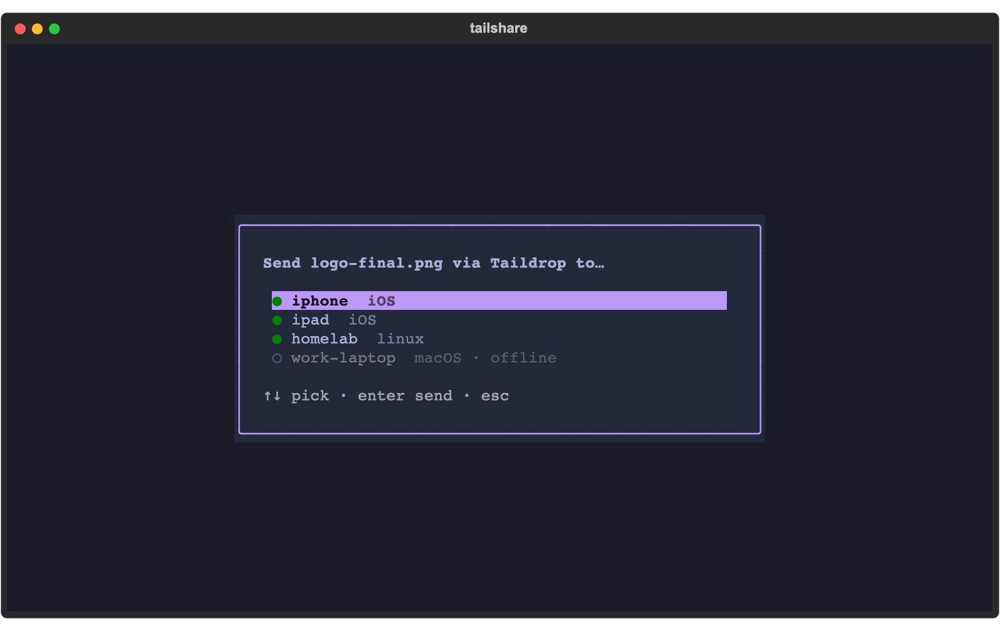
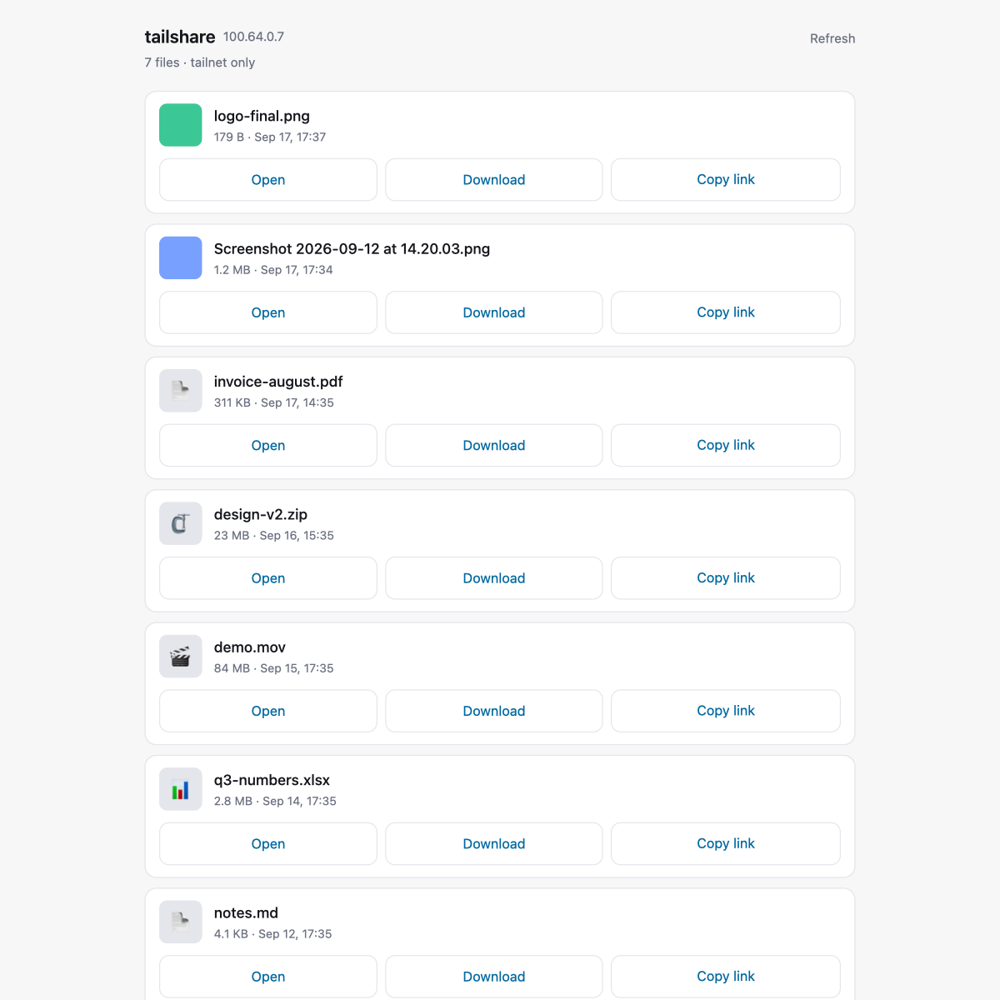
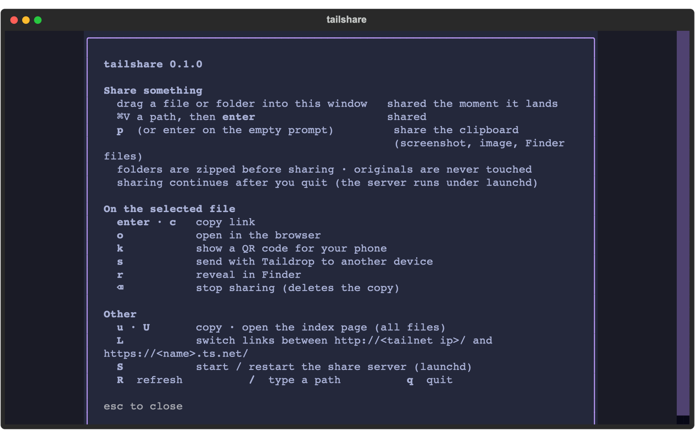

<h1 align="center">tailshare</h1>

<p align="center">
  Drop a file into your terminal. Get a link that works on every device in your tailnet.
</p>

<p align="center">
  
</p>

---

`tailshare` is a small macOS terminal app for the "I need this file on my phone / the other laptop / the
server" moment. Drag a file into the window (or paste a screenshot) and it is instantly available at
`http://100.x.y.z/<file>` to anything logged into your [Tailscale](https://tailscale.com) network,
with the link already on your clipboard. Nothing leaves the tailnet.

## Features

- **Drag and drop.** Drop a file or folder from Finder into the terminal window. It is shared the moment
  it lands. Folders are zipped first. Originals are never moved or modified.
- **Clipboard.** Press `p` to share whatever is on the clipboard: a screenshot (`⌘⇧⌃4`), an image
  copied from a browser, or files copied in Finder with `⌘C`.
- **Links that just work.** Plain `http://<tailnet ip>/file` links by default, so they work on devices
  without MagicDNS. Flip to `https://<name>.ts.net/` with `L`.
- **See what is shared.** Newest first, with size and age. Copy the link, open it, show a QR code for
  your phone, send the file with Taildrop, reveal it in Finder, or stop sharing it.
- **Survives reboots.** The share server runs under a `launchd` agent. Close the TUI, the links keep working.
- **A web index for other devices.** Open the base URL on a phone and get a touch-friendly page with
  thumbnails and Open / Download / Copy link per file.

<p align="center">
  
  
</p>

<p align="center">
  
</p>

## Install

Requirements: macOS, the [Tailscale app](https://tailscale.com/download/mac), and
[uv](https://docs.astral.sh/uv/). Python is fetched by uv if needed.

```sh
uv tool install git+https://github.com/nicscl/tailshare
tailshare install     # one time: launchd agent + tailscale serve routes
tailshare             # open the TUI
```

`tailshare install` needs HTTPS certificates enabled on your tailnet for the DNS links
(Tailscale admin console → DNS → HTTPS Certificates). IP links work without it.

## Keys

| Key | Action |
|-----|--------|
| *drop a file* | share it, copy the link |
| `p` | share the clipboard (screenshot, image, Finder files) |
| `/` | type or paste a path, `enter` to share, `esc` to go back |
| `enter` / `c` | copy link of the selected file |
| `o` | open it in the browser |
| `k` | QR code, for scanning with a phone |
| `s` | send with Taildrop to another device |
| `r` | reveal in Finder |
| `⌫` | stop sharing (deletes the shared copy, never the original) |
| `L` | toggle IP / DNS links |
| `u` / `U` | copy / open the index page |
| `S` | start or restart the share server |
| `?` / `q` | help / quit |

<p align="center">
  
</p>

## Non-interactive use

```sh
tailshare add ~/Desktop/report.pdf -c   # share, print the URL, copy it
tailshare add ./build/                  # folders are zipped
tailshare paste -c                      # share the clipboard
tailshare ls                            # everything shared, with URLs
tailshare url report.pdf
tailshare rm report.pdf
tailshare status                        # server, launchd, tailscale, serve routes
```

## How it works

```
 Finder drop / clipboard
          │
          ▼
  ~/Public/ts-share  ◀──  tailshare serve  (127.0.0.1:8787, localhost only)
                                  ▲
                                  │  tailscale serve
        ┌─────────────────────────┴──────────────────────────┐
        │  --tcp=80  raw forward   →  http://100.x.y.z/        │  default links
        │  https/443 proxy         →  https://<name>.ts.net/   │  L to switch
        └────────────────────────────────────────────────────┘
```

- Files are copied into `~/Public/ts-share` (override with `TAILSHARE_DIR`). Copies are staged as
  hidden `.part` files and renamed into place, so a half-copied file is never served.
- `tailshare serve` is a small HTTP server bound to localhost. It never listens on a network interface;
  only Tailscale can reach it. Hidden files and symlinks are never listed or served, and shared HTML
  is served with a sandboxing CSP.
- The App Store build of Tailscale cannot serve a directory directly ("Path serving is not supported on
  macOS"), which is why a local server is needed at all. A plain `--http=80` route also does not work
  for bare-IP links, because it matches on the Host header; the raw TCP forward on port 80 avoids that.
- `tailshare install` writes `~/Library/LaunchAgents/com.nicholas.tailshare.plist` (KeepAlive,
  RunAtLoad) and configures both serve routes. Logs go to `~/Library/Logs/tailshare.log`.

## Configuration

| Variable | Default | Meaning |
|----------|---------|---------|
| `TAILSHARE_DIR` | `~/Public/ts-share` | folder that is shared |
| `TAILSHARE_PORT` | `8787` | localhost port of the share server |
| `TAILSHARE_SERVE` | `1` | `0` leaves `tailscale serve` alone (agent mailbox only, no file links) |
| `TAILSHARE_SHARE_PANES` | `1` | `0` keeps agents' tmux panes and login out of what other machines can read |
| `TAILSHARE_SSH_ENROLL` | `1` | `0` refuses SSH key requests from devices |
| `TAILSHARE_LINKS` | `ip` | `ip` for `http://100.x.y.z/`, `dns` for `https://<name>.ts.net/` |

Set them before `tailshare install` so the launchd agent picks them up.

## Agent messaging

AI agents (Claude Code, Codex) on any machine in the tailnet can message each other. There is no hub:
each machine's share server is also a **mailbox** for the agents on that machine, and messages for a
machine that is asleep or offline wait in the sender's outbox and are delivered when it comes back.

Every agent has an address `host/harness/folder[/session]`, e.g. `macbook-air/claude/tailshare/hub-design`.
The session part is the name set with `/rename` (Claude Code) or the thread name (Codex). A prefix reaches
everything under it (`macbook-pro/codex/api`) and globs work (`*/*/tailshare` is every agent in a
`tailshare` folder on any machine).

```sh
tailshare agent install-claude          # every new Claude Code session joins (hooks + MCP server)
tailshare agent whoami                  # this session's address
tailshare agent ls                      # agents here and on other machines
tailshare agent send '*/*/api' "migration is ready" --file schema.sql
tailshare agent inbox                   # read new messages
tailshare agent watch [--once]          # print messages as they arrive (for Monitor / background Bash)
tailshare agent outbox                  # what is waiting for an offline machine
tailshare agent ls --attach             # agents running in tmux, with a command to attach to each pane
```

**tmux panes.** An agent started inside tmux registers its pane (socket, pane id, `session:window.pane`, tmux
path) and the account it runs as. `agent ls --attach` prints `ssh -t <login>@<host> tmux -S <socket> attach -t
<pane> ...` for each one, and any device on the tailnet can read the same from a machine's `GET
http://<tailnet ip>:8789/bus/v1/hello` (header `X-Tailshare: 1`), so an app can list agents and open their panes.
This only says where a pane is; attaching still needs SSH access to that machine. `TAILSHARE_SHARE_PANES=0`
leaves panes out of `/hello`. `/hello` also answers `you: {user, node}`, what the tailnet says about the caller.
Devices without `tailscale status` (phones) find the rest with `GET /bus/v1/peers`: the machines running tailshare
that this one has heard from, as `{host, ip, port, owner, online, ssh_host_keys, self}`, all from `tailscale status`
(never from what a peer says). Only the machine owner's own devices may ask. Each pane in `/hello` carries
`alive`, from the same `tmux display` check the SSH gate makes.

**SSH keys for devices.** A device without tailshare (a phone app) can ask a machine for an SSH key over
`POST /bus/v1/keys/enroll`. Nothing is installed until a person runs `tailshare keys approve` on that
machine and confirms the fingerprint. The key can then only attach to agents' tmux panes, which still means
typing into a shell or an agent: treat it as shell access. See [docs/ssh-keys.md](docs/ssh-keys.md).

How messages reach an agent:

- **Claude Code**: a SessionStart hook registers the session and tells it to run `tailshare agent watch --once`
  in the background; it exits when a message arrives, which wakes the session. A UserPromptSubmit hook
  also delivers anything waiting. `tailshare agent watch` (without `--once`) works under the Monitor tool.
- **Any MCP client** (Claude Code, Codex): `tailshare mcp` exposes `whoami`, `agents`, `send` and `inbox`.

**Users.** Every session has a human user: the tailnet user of the device that SSH'd in (from
`SSH_CONNECTION`), otherwise the tailnet owner of the machine, or `TAILSHARE_USER` if set. `@nick` reaches
every session of that person on every machine, `@nick/*/*/api` only their sessions in an `api` folder.

**Updates.** Installs from git keep themselves current: every hour (`TAILSHARE_UPDATE_HOURS`) each server
checks the branch it follows (`TAILSHARE_UPDATE_REF`, default `main`) on the repo it was installed from,
installs the new commit, checks that it loads (rolling back if not) and restarts. `TAILSHARE_AUTOUPDATE=0`
turns this off. Editable checkouts are never touched.

```sh
tailshare update          # update this machine now
tailshare update --all    # ...and ask every other machine to update too
tailshare machines        # every machine running tailshare, with its version
```

A request to update can only come from machines of the same tailnet user, and it only says "check now":
what gets installed always comes from the repo recorded in that machine's own install.

**Sessions.** Every mailbox also indexes the Claude Code and Codex sessions on its machine, so you can find
an old session wherever it ran, ask it a question, or reopen it. See [docs/sessions.md](docs/sessions.md).

```sh
tailshare sessions find stripe webhook                 # search sessions on every machine
tailshare sessions show prismo:3f2a91c0                # details (refs are host:id-prefix)
tailshare sessions open prismo:3f2a91c0                # resume it in this terminal (over SSH if remote)
tailshare sessions ask prismo:3f2a91c0 "why pg_dump?"  # a throwaway copy with no tools answers
tailshare sessions launch prismo:3f2a91c0 --mode acceptEdits --prompt "run the tests"   # signed, see below
```

Agents get the same through MCP (`find_sessions`, `ask_session`). Only machines of the same tailnet user can
search or ask. `launch` resumes a session in the background with real permissions, so it needs a request
signed by a key that machine trusts (`tailshare sessions trust <key.pub>`, run on that machine by hand),
ideally a FIDO key that needs a touch. It never runs as root and never bypasses permissions.

Details:

- The mailbox listens on `127.0.0.1:8789` for local agents and on the tailnet IP `:8789` for other
  mailboxes (`TAILSHARE_BUS_PORT`). State is in `~/.tailshare/bus.db` (`TAILSHARE_STATE`).
- Other machines are found with `tailscale status`; machines that do not run tailshare simply do not answer.
- The host part of a sender's address is checked against the tailnet IP it connects from.
- Messages are delivered at least once and expire after 7 days. Agents are told to treat them as
  information from a peer, not as instructions from the user.

## On an iPad (iSH)

tailshare also runs inside [iSH](https://ish.app) on iOS, TUI included. There is no Tailscale CLI
there, so instead of `tailscale serve` the server binds the iPad's tailnet IP directly (iOS lets iSH
bind port 80). The server and TUI run only while iSH is in the foreground.

```sh
apk add python3 py3-pip && pip install --break-system-packages textual qrcode   # in iSH
mkdir -p ~/tailshare && cd ~/tailshare           # copy the tailshare/ package folder here
export TAILSHARE_BIND=100.x.y.z TAILSHARE_PORT=80 TAILSHARE_BASE_URL=http://100.x.y.z/
export TAILSHARE_DIR=~/ts-share PYTHONPATH=~/tailshare TAILSHARE_POLL=5
python3 -m tailshare                             # TUI; S starts the server, links are http://100.x.y.z/<file>
```

**Drag and drop on the iPad** goes through the Files app: iSH publishes its filesystem there, so open
Files next to iSH in Split View and drop files onto *iSH › root › ts-share*. They are copied into
iSH and appear in the TUI and on the index within a few seconds. Copying a link uses the iOS
clipboard via `/dev/clipboard`. Reveal, Taildrop and launchd are not available on iOS and say so.

| Variable | Default | Meaning |
|----------|---------|---------|
| `TAILSHARE_BIND` | `127.0.0.1` | address the share server listens on |
| `TAILSHARE_BASE_URL` | *(unset)* | link prefix to use when there is no Tailscale CLI, e.g. `http://100.x.y.z/` |
| `TAILSHARE_POLL` | `2` | seconds between share-folder refreshes in the TUI; raise on slow hosts |

## Troubleshooting

- **Link opens on the phone but not in Chrome on the Mac.** Chrome's Secure DNS can hide MagicDNS
  names. Use the IP link, or turn off Secure DNS in Chrome.
- **Status shows `server offline`.** Press `S` in the TUI, or run `tailshare install`. Check
  `~/Library/Logs/tailshare.log`.
- **Status shows a serve route `MISSING`.** `tailshare install` re-applies both routes. If your tailnet
  has HTTPS certificates disabled, the DNS route fails but IP links still work.
- **A drop types the path instead of sharing.** Your terminal did not send it as a paste. Press `/`
  first, then drop; `enter` shares it.

## Development

```sh
git clone https://github.com/nicscl/tailshare && cd tailshare
uv tool install --editable .     # edits are live
uv run python -m tailshare       # or run from the checkout
```

Built with [Textual](https://textual.textualize.io). The drag-and-drop path was verified against
iTerm2's bracketed paste, and the UI was reviewed with a second model before shipping.
